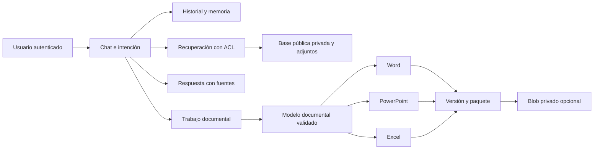

# Arquitectura e integración

## Flujo

Una creación estándar usa intención, contenido y revisión consultiva. Si hay errores materiales, permite una reparación y una segunda revisión, con un límite explícito. Una consulta usa intención y respuesta. La recuperación se realiza una vez por turno. Crear los tres formatos reutiliza el mismo contenido validado y no llama al modelo tres veces. Las revisiones estructuradas no llaman al modelo.

No hay agentes que se deleguen recursivamente. Se evita una cadena larga de planeación, redacción, revisión y reescritura ilimitadas. Esta decisión reduce llamadas, pero la calidad debe evaluarse con entregables reales. La generación en segundo plano mantiene el chat disponible; por sí misma no reduce el tiempo total del modelo.

## Puntos de conexión

| Tu servicio existente | Punto de integración |
|---|---|
| Autenticación y sesiones | Construir `Principal` exclusivamente a partir de identidad validada y mantener un `conversation_id` autorizado. |
| Búsqueda actual | Sustituir `Knowledge.retrieve` conservando su contrato `list[Source]` y el filtrado previo de permisos. |
| Blob de bibliotecas | Conservar la ingesta e indexación actual. Este asset consulta el índice, no necesita leer cada Blob en cada turno. |
| Adjuntos | Reutilizar tu extracción y producir chunks autorizados. El parser local es una alternativa de referencia. |
| Modelo | Implementar `generate(schema, instructions, context, role, images)` si tu gateway no ofrece Responses v1. |
| Persistencia | Sustituir Store por tu base corporativa preservando autorización y transacciones. |
| Cola | Sustituir ThreadPoolExecutor por Service Bus u otra cola compartida si hay múltiples réplicas. |
| Archivos finales | Mantener descargas autenticadas o publicar versiones en Blob privado con acceso temporal autorizado. |

## Contrato del índice Azure AI Search

El adaptador utiliza estos nombres. Si tu índice tiene otros, mapea los campos en `providers.py`.

| Campo | Tipo | Requisito |
|---|---|---|
| id | Edm.String | clave única por chunk |
| title | Edm.String | nombre legible de fuente |
| content | Edm.String | searchable y retrievable |
| locator | Edm.String | página, sección o ubicación verificable |
| tenant_id | Edm.String | filterable |
| scope | Edm.String | filterable; base, public, private o conversation |
| owner_id | Edm.String | filterable; obligatorio para private y conversation |
| conversation_id | Edm.String | filterable; obligatorio para conversation |

El filtro exige tenant y admite fuentes compartidas, privadas del usuario o adjuntos de esa conversación. Un resultado remoto se vuelve a comprobar antes de entrar al contexto. El API nunca acepta `tenant_id`, `owner_id` ni filtros arbitrarios suministrados por el cliente.

Las bibliotecas base y pública se distinguen por procedencia y administración. Ambas son compartidas dentro del tenant en este contrato. Si tu pública es global entre empresas, implementa explícitamente esa política con una fuente separada; no elimines el filtro de tenant de un índice que también contenga documentos privados.

Este adaptador utiliza búsqueda de texto. Puedes sustituirla por tu recuperación híbrida o semántica existente y conservar los mismos permisos. No se crean embeddings ni índices nuevos automáticamente.

## Modelo documental

`models.py` es el contrato versionable. Contiene propósito, audiencia, resumen, decisión, secciones libres, hallazgos clasificados, riesgos, controles, acciones, indicadores, proceso, plan de láminas y plan de workbook opcional.

La primera clase de diferenciación es la trazabilidad: una acción enlaza controles y un control enlaza riesgos. Un hecho identifica fuentes. Los resultados desconocidos permanecen nulos. Los IDs permiten comparar versiones y modificar una actividad concreta.

La segunda es adaptar el entregable a su uso: Word explica y prescribe, PowerPoint comunica decisiones y Excel opera con registros y cálculos. El generador conserva reglas de diseño deliberadas. Esas reglas son distintas de imponer texto, una paleta fija o la misma tabla de contenido a todos los clientes.

`workbook` permite datasets arbitrarios, columnas tipadas, métricas y gráficas. Sus operaciones permitidas son count, sum, average, count_equal y ratio_sums. No se aceptan fórmulas ni Python arbitrarios del modelo. Para fórmulas más complejas, agrega operaciones probadas al motor y documenta su semántica.

## Diseño de marca

El cliente configura colores y logo en la conversación. Al subir PNG/JPEG se sugiere una paleta por frecuencia de color. Es una heurística, no una reproducción automática de un manual de marca. El usuario puede corregirla. Cuando se conecta el modelo, también recibe el logo como imagen para contexto visual.

Un archivo existente conserva su tema. Cambiar la marca de la conversación afecta nuevas creaciones. Para cambiar una versión anterior, usa una revisión conversacional o estructurada de su tema. Los IDs de logos se autorizan por conversación antes de renderizar.

## Documentos de gran extensión

Cuando el enrutador identifica una petición explícita de 16 páginas o más, activa este flujo:

1. Generar un plan completo y secciones con esquemas breves.
2. Expandir las secciones con concurrencia `GS_SECTION_WORKERS` y fuentes relevantes.
3. Compartir riesgos, controles, acciones y supuestos para conservar consistencia.
4. Verificar identidad de cada sección y ejecutar la revisión consultiva.
5. Ensamblar y publicar únicamente si las estructuras y referencias son válidas.

El presupuesto orientativo utiliza 350 palabras por página, repartidas por sección y acotadas por llamada. La paginación real depende del contenido y diseño. No se rellena para alcanzar páginas ni se garantiza un número exacto. Este flujo tiene pruebas con proveedor simulado; su calidad, costo y tiempo deben medirse con tus modelos y cuotas. Las revisiones extensas aún devuelven el modelo completo en una llamada y pueden alcanzar el límite de salida.

## Revisión consultiva

En Azure, `GS_SEMANTIC_REVIEW=1` activa un segundo paso que busca afirmaciones sin respaldo, omisiones materiales y contradicciones. Si detecta errores bloqueantes, se intenta una reparación y se revisa otra vez. Si persisten, el trabajo falla. Las recomendaciones se guardan en `quality.json`.

Este revisor utiliza el mismo deployment documental, por lo que no constituye una comprobación independiente ni garantiza exactitud. No puede evaluar diseño visual porque recibe la estructura, no las páginas renderizadas. El modo demo omite esta llamada y las ediciones estructuradas solo pasan controles deterministas. Para desactivar este paso en pruebas de latencia, usa `GS_SEMANTIC_REVIEW=0` y registra esa configuración en la comparación.

## Condiciones para operación corporativa

El servidor de referencia incluye tokens, límites de solicitudes, protección de rutas, límite de adjuntos y cola acotada. Para exponerlo fuera de desarrollo, integra TLS, SSO, secretos administrados, volumen cifrado, políticas de retención y eliminación y auditoría corporativa. No hay endpoint de eliminación en esta versión.

La extracción de archivos sucede dentro del proceso. Si aceptarás archivos de usuarios externos, utiliza el servicio corporativo de análisis de archivos y aislamiento de parsers. Los límites locales no sustituyen ese servicio.

Se conserva historial completo, memoria, texto extraído y versiones en el directorio configurado. Protege ese directorio y sus respaldos. El parámetro `store:false` evita solicitar almacenamiento de respuestas en el proveedor, pero no modifica por sí mismo las políticas de procesamiento o retención de Azure.

Blob opcional publica bajo prefijos derivados del tenant y usuario con hash, artifact ID y versión. No crea contenedores ni habilita acceso público. La descarga de referencia utiliza la copia local autorizada; una implementación sin disco persistente debe añadir lectura desde Blob. No configures la publicación de Blob si no necesitas esta segunda copia.

Los eventos registran etapas, tiempos, deployment y uso de tokens, no el contenido de prompts. La base sí almacena el contenido como parte funcional de la conversación. Evita confundir ambas formas de almacenamiento.
